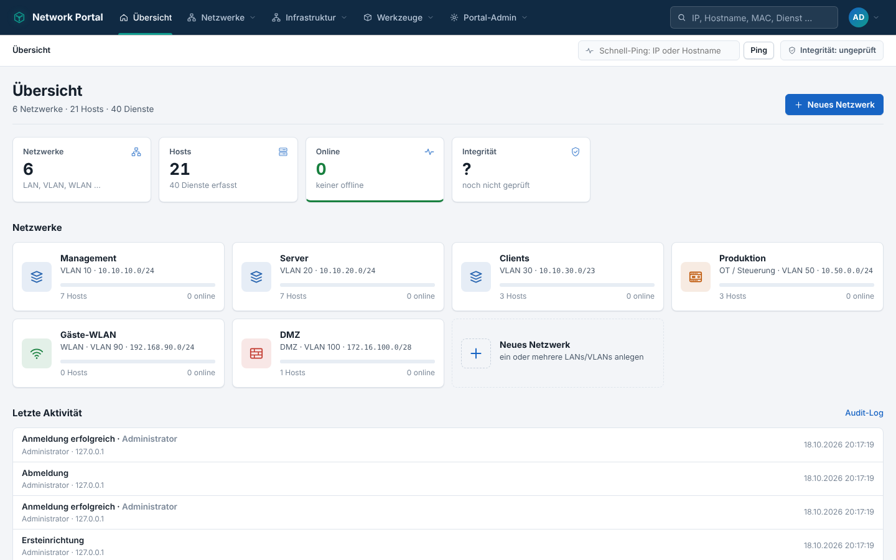
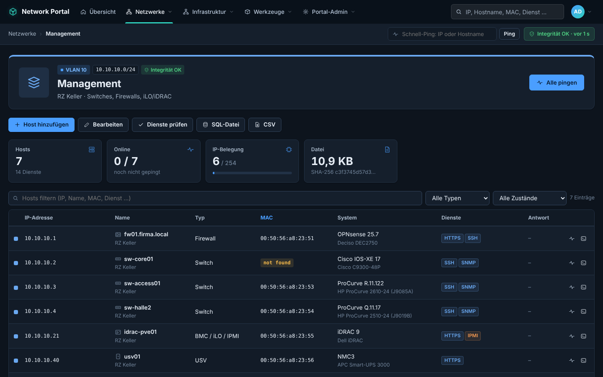
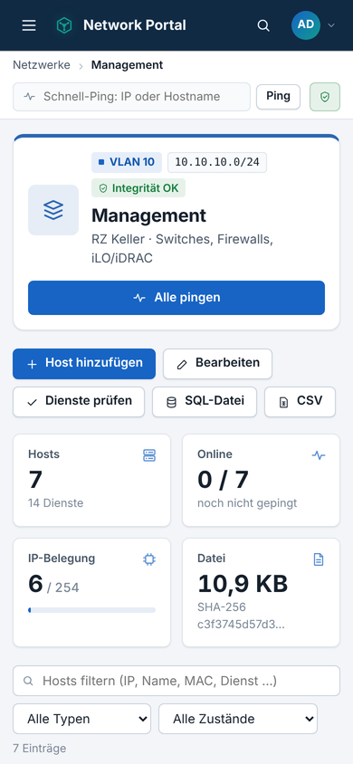

# Network Portal

LANs und VLANs verwalten wie in einer Datenbank – mit Ping, Dienst-Übersicht,
iperf3 und SSH je Eintrag, Integritätsprüfung (Hash je Eintrag und je Datei),
sehr detailliertem Audit-Log und Anmeldung über lokale Konten, PAM,
PAM + YubiKey, LDAP / Windows Active Directory sowie YubiKey (FIDO2/WebAuthn
und Yubico-OTP). **Reines PHP**, keine Abhängigkeiten, keine Skripte, Schriften
oder Stylesheets von Dritten. Oberfläche auf **Deutsch und Englisch**, hell oder
dunkel nach Systemeinstellung, auch am Handy bedienbar.

*English:* A self-hosted, dependency-free PHP portal to document and operate
LANs/VLANs: hosts and services per network, ping/iperf3/SSH from the server,
switch ports and VLANs, WAN links, a topology map (NetMap), tamper-evident storage
(HMAC per row and file), a hash-chained audit log and sign-in via local accounts,
PAM, LDAP/AD and YubiKey. UI in German and English.

**Demo zum Ansehen im Browser:** https://slukas77.github.io/netportal/demo/ (English: https://slukas77.github.io/netportal/demo/en/) – echte Seiten des Portals
mit Beispieldaten (Deutsch/Englisch, hell/dunkel, Handy). Speichern, Ping und SSH brauchen den
Server und sind in der Demo nur angedeutet.



## Funktionen

- **Netzwerke** als eigene SQL-Datei je LAN/VLAN mit Hosts, Diensten und Netzdaten
- **Ping, Dienst-Prüfung, iperf3, SSH-Terminal** – alles läuft auf dem Server, nichts im Browser
- **Switches** mit Frontansicht, Port-Belegung, VLANs und Konfigurations-Export (HP ProCurve u. a.)
- **WAN-Anschlüsse** mit Vertrag, Zugang, Adressen und Erreichbarkeit
- **NetMap**: Weg jedes Geräts bis ins Internet, abgeleitet aus den Einträgen
- **Master**: ein Gerät (z. B. Firewall) in mehreren Netzwerken auf der ersten IP eintragen
- **Caddyfile-Generator**, Logos nach Betriebssystem, Windows-Symbole fest eingebaut
- **Integrität**: HMAC je Zeile und Datei, Siegel, Prüfsumme der Programmdateien
- **Audit-Log** als Hash-Kette mit automatischer Aufbewahrung (Standard 90 Tage)
- **Rollen** Leser, Power-User, Portal-Admin – serverseitig je Aktion geprüft

| Netzwerk (dunkel) | Handy |
|---|---|
|  |  |

## NetMap

Menü „Infrastruktur → NetMap“ zeigt, welches Gerät wo angeschlossen ist – abgeleitet
aus den vorhandenen Einträgen, nichts wird geraten:

- **Plan** Internet → WAN-Anschluss → Router → Switches → Geräte. Kanten tragen Port,
  Netzwerk (untagged, Farbe) und tagged Netzwerke; Trunks gestrichelt, weitere
  Verbindungen (z. B. Backup-Leitung am selben Router) gepunktet. Klick öffnet den Eintrag.
- **Netzwerk hervorheben** und **Weg eines Geräts zeigen** (auch von der Seite des Eintrags).
- **Verbindungsliste** mit „Hängt an“ und dem ganzen Weg ins Internet, Einträge **ohne
  Anschluss-Information** je Netzwerk, und welche Switches welches Netzwerk tragen.
- Grundlage: Router im WAN-Anschluss, verknüpfter Eintrag je Switch und „Angeschlossenes
  Gerät“ je Switch-Port. Hängt ein Switch an einem Port eines anderen Switches, ist das sein
  Uplink. Wird ein Eintrag oder Netzwerk gelöscht, entfernt das Portal die Verweise darauf.
- Kommandozeile: `php bin/netportal-cli.php netmap`

## Rollen

| Rolle | Darf |
|---|---|
| **Leser** | nur lesen: ansehen, exportieren (SQL/CSV) – kein Ping, kein iperf3, kein SSH, nichts anlegen, ändern oder löschen |
| **Power-User** | wie Leser, zusätzlich Werkzeuge: Ping (auch „Alle pingen“, Schnell-Ping, WAN-Prüfung), Dienste prüfen/erkennen, iperf3, SSH-Terminal, SSH-Befehle aus der Freigabeliste, Caddyfile-Generator, Switch-Konfiguration erzeugen |
| **Portal-Admin** | alles: anlegen, bearbeiten, löschen (auch Switches, WAN-Anschlüsse, Vorlagen), WAN-Passwörter anzeigen, Master, MAC-Erkennung, Einstellungen, Audit-Log, Benutzerverwaltung, Integrität/Neu-Versiegeln, System & Pakete, Diagnose & Debug |

`Administrator`, der per PAM angemeldete `root` sowie `administrator@…` und
`root@…` sind immer Portal-Admin. Konten aus 1.0 werden beim ersten Start
automatisch nach `users.sql` übernommen. Aus der Rolle *Operator* wird dabei
*Power-User*.

## Voraussetzungen

- PHP 8.1+ mit `pdo_sqlite`, `openssl`, `mbstring`, `zlib`
  - optional `ldap` (AD/LDAP) und `sodium` (Ed25519-Keys)
- Webserver mit PHP-FPM (Caddy, nginx oder Apache) und **HTTPS** (für WebAuthn)
- Optionale Werkzeuge, alle unter *System & Pakete* installierbar:
  - `iputils-ping`, `openssh-client`, `iperf3`
  - `iproute2`, `samba-common-bin`, `ieee-data`, `snmp` (Erkennung)
  - `ldap-utils`
  - `libpam-yubico`, `libpam-u2f`, `pamtester`
  - `build-essential`, `libpam0g-dev` (zum Bauen des PAM-Helfers)

## Installation

### Schnell: `install.sh` (Debian/Ubuntu, Caddy, PHP 8.5)

```bash
git clone https://github.com/slukas77/netportal.git
cd netportal
nano install.sh          # Abschnitt ANPASSEN: DOMAIN, Zertifikat, erlaubte Netze …, dann CONFIGURED="yes"
sudo ./install.sh
```

Das Skript bricht ab, solange die Werte nicht angepasst sind. Es

- installiert PHP 8.5 (bei Bedarf aus der Paketquelle von Ondřej Surý) und Caddy (offizielle Quelle),
- kopiert das Portal nach `INSTALL_DIR` – Programmdateien nur lesbar, nur `config/`, `database/`,
  `.cache/` und `icons/` für PHP beschreibbar; Caddy darf nur `assets/` lesen,
- legt einen eigenen PHP-FPM-Pool und `/etc/caddy/caddy.d/netportal.conf` an (Zertifikat wahlweise
  Let's Encrypt, Caddy-intern, eigener ACME-Server oder vorhandene Dateien; Zugriff standardmäßig nur
  aus privaten Netzen; alle Daten- und Programmordner gesperrt),
- richtet die cron-Prüfungen ein und hält die Prüfsummen der Programmdateien fest.

Erneut ausführen aktualisiert die Programmdateien; Einstellungen und Daten bleiben erhalten.

### Von Hand

```bash
sudo git clone https://github.com/slukas77/netportal.git /var/www/netportal
sudo chown -R www-data:www-data /var/www/netportal
sudo chmod 750 /var/www/netportal/{config,database,icons,.cache}
sudo apt install php8.5-fpm php8.5-cli php8.5-sqlite3 php8.5-mbstring openssh-client
```

Webserver-Konfiguration aus `server/` übernehmen (Caddyfile, nginx.conf; für
Apache liegen `.htaccess`-Dateien bei). Danach die Seite aufrufen: die
**Ersteinrichtung** legt das lokale Konto `Administrator` in `users.sql` an und
erzeugt den Integritätsschlüssel.

Danach die Prüfsummen der Programmdateien festhalten (auch nach jedem Update):

```bash
cd /var/www/netportal && sudo -u www-data php bin/netportal-cli.php manifest
```

### Installations-Helfer (einmalig, als root)

Damit Portal-Admins unter *System & Pakete* per Klick installieren können:

```bash
sudo php /var/www/netportal/system/install.php            # PHP-FPM läuft als www-data
sudo php /var/www/netportal/system/install.php caddy      # anderer PHP-FPM-Benutzer
sudo php /var/www/netportal/system/install.php --uninstall
```

Das richtet `/usr/local/sbin/netportal-admin` (PHP) und eine sudo-Regel nur für
diesen Helfer ein. Der Helfer darf ausschließlich:

- `status`
- `install` mit Paketen aus einer festen Liste (apt, nur Debian/Ubuntu)
- `pam-helper`: PAM-Helfer bauen und installieren

Die PAM-Quellen liegen dafür in `/usr/local/share/netportal` (root-eigen), nicht
im Web-Ordner. Jede Installation steht mit Protokoll im Audit-Log.

Ohne Webserver zum Ausprobieren: `PHP_CLI_SERVER_WORKERS=8 php -S 127.0.0.1:8080 router.php`
(Beispieldaten: `php bin/netportal-cli.php demo`).

## Dateien

| Pfad | Inhalt |
|---|---|
| `database/net-<name>.sql` | je Netzwerk eine SQL-Datei (Hosts, Dienste, Netzdaten) |
| `database/users.sql` | Benutzer des Portals, YubiKeys (WebAuthn/OTP) – mit Hash je Zeile und Datei |
| `database/_system.sqlite` | Audit-Log (Aufbewahrung 90 Tage), Siegel, Schlüsselteil 1 |
| `database/archiv/` | gelöschte Netzwerke (Datei wird verschoben, nicht vernichtet) |
| `config/settings.json` | Einstellungen |
| `config/integrity.key` | Schlüsselteil 2 (0600) – **getrennt sichern** |
| `config/ssh/` | SSH-Schlüssel und known_hosts des Portals |
| `icons/brands/` | geladene Logos (Simple Icons, CC0) + Lizenztext |
| `icons/custom/` | hochgeladene eigene Icons |
| `database/masters.sql` | Master-Vorlagen und abgehakte Netzwerke – mit Hash je Zeile und Datei |
| `database/switches.sql` | Switches, Ports (Netzwerke untagged/tagged, Geräte), VLANs, eigene Switch-Vorlagen |
| `database/wan.sql` | WAN-Anschlüsse (Passwort verschlüsselt) und eigene WAN-Vorlagen |
| `database/terminal/` | optionale Aufzeichnungen des SSH-Terminals |
| `config/caddy-presets.json` | gespeicherte Vorlagen des Caddyfile-Generators |
| `.cache/` | Sitzungen, Live-Status (Ping, Dienste, iperf3), Sperren, Terminal-Sitzungen, Debug-Protokoll |
| `includes/lang/en.php` | englische Texte (Schlüssel = deutscher Text) |

Die Live-Ergebnisse von Ping, Dienst-Prüfung und iperf3 stehen bewusst
**nicht** in den SQL-Dateien. Sonst würde jede Prüfung die Datei und ihr
Siegel ändern.

## Icons und Lizenzen

- Die **eigenen Symbole** sind im Portal selbst gezeichnet und frei verwendbar.
- **Logos** stammen aus [Simple Icons](https://simpleicons.org) unter
  **CC0 1.0** (gemeinfrei). Sie werden nicht mitgeliefert. Ein Portal-Admin
  lädt sie unter *Einstellungen → Icons* aus dem offiziellen npm-Paket
  `simple-icons`:
  - Die sha512-Prüfsumme aus der Registry wird kontrolliert.
  - Ohne Internet das Paket als `.tgz` hochladen: `npm pack simple-icons`
    auf einem anderen Rechner ausführen. PHP braucht dafür ein
    `upload_max_filesize`/`post_max_size` passend zur Paketgröße.
  - Der Lizenztext wird unter `icons/brands/LICENSE-simple-icons.md`
    abgelegt.
  - Hinweis: CC0 gilt für die Grafikdateien. Die Marken gehören ihren
    Inhabern; die Logos dienen nur zur Kennzeichnung der jeweiligen Software.
- Eigene SVGs mit Skripten, Event-Attributen oder externen Verweisen werden
  abgelehnt. Eigene Icons werden mit `Content-Security-Policy: sandbox`
  ausgeliefert.

## Integrität

- **Je Eintrag**: `row_hash = HMAC-SHA256(Schlüssel, Kurzname + Tabelle + Inhalt)`
  – gilt für Netzwerk-Dateien und `users.sql`.
- **Je Datei**: letzte Zeile `-- integrity: hmac-sha256=…` über den gesamten
  Inhalt, zusätzlich SHA-256-Siegel in der System-DB.
- **Schlüssel**: zweigeteilt (System-DB + `config/integrity.key`). Wer nur an
  die Datenbank-Dateien oder nur an `config/` kommt, kann keine gültigen Hashes
  erzeugen. Fehlt ein Teil, bleibt das Portal gesperrt.
- **Sicheres Laden**: Die SQL-Dateien werden nicht von SQLite ausgeführt,
  sondern von einem strengen Parser gelesen – eingeschleuste Anweisungen
  (z. B. `ATTACH DATABASE`) werden nur gemeldet, nie ausgeführt.
- **Schreibschutz**: Stimmt eine Datei nicht mit ihrem Siegel überein, lehnt
  das Portal Änderungen daran ab. Unter *Integrität* kann ein Portal-Admin
  nach Prüfung mit Begründung neu versiegeln (optional inkl. Neuberechnung der
  Zeilen-Hashes) – alles im Audit-Log.
- Dateien aus 1.0 bleiben gültig. Neue Spalten, die leer sind, fließen nicht in
  den Hash ein. Beim nächsten Speichern wird eine Datei auf Format 2 gebracht.

Regelmäßig prüfen (cron, als Webserver-Benutzer):

```
*/30 * * * * www-data php /var/www/netportal/bin/netportal-cli.php check >/dev/null || logger -t netportal "Integritaet verletzt"
*/5  * * * * www-data php /var/www/netportal/bin/netportal-cli.php ping >/dev/null
*/15 * * * * www-data php /var/www/netportal/bin/netportal-cli.php services >/dev/null
*/5  * * * * www-data php /var/www/netportal/bin/netportal-cli.php wan:check >/dev/null || logger -t netportal "WAN-Anschluss ausgefallen"
```

Die cron-Befehle schreiben nur bei Zustandswechseln ins Audit-Log (plus einmal täglich eine
Zusammenfassung) und übernehmen auch die tägliche Audit-Aufbewahrung.

Nach einem Programm-Update: `php bin/netportal-cli.php manifest`.

## Anmeldung

### PAM

Unter *System & Pakete* „PAM-Helfer installieren“ (benötigt `build-essential`
und `libpam0g-dev`, ebenfalls dort installierbar). Danach unter *Einstellungen
→ Anmeldung* „PAM“ aktivieren und mit dem **PAM-Tester** prüfen.

Zum PHP-only-Wunsch: Alles im Portal ist PHP – bis auf den kleinen
**PAM-Helfer** `pam-helper/pam_check.c`. PHP hat keine eingebaute
PAM-Schnittstelle, und zum Prüfen lokaler Unix-Passwörter braucht es root
(Lesen von `/etc/shadow`). Der Helfer:

- ist setuid root
- kennt nur die Dienste `netportal` und `netportal-yubikey`
- bekommt das Passwort nur über stdin

Wer gar keinen C-Code möchte, stellt unter *Einstellungen → Anmeldung* den
PAM-Mechanismus auf **`pamtester`** (Paket `pamtester`). Einschränkung: Ohne
root kann pamtester lokale Unix-Passwörter nicht prüfen. Für sssd-/AD-Konten
über PAM reicht es.

Von Hand bauen statt per Klick:

```bash
sudo cc -O2 -o /usr/local/sbin/netportal-pam-check pam-helper/pam_check.c -lpam
sudo chgrp www-data /usr/local/sbin/netportal-pam-check
sudo chmod 4750 /usr/local/sbin/netportal-pam-check     # nur der Webserver darf ihn aufrufen
sudo cp pam-helper/netportal.pam /etc/pam.d/netportal
sudo cp pam-helper/netportal-yubikey.pam /etc/pam.d/netportal-yubikey
```

### PAM + YubiKey

`/etc/pam.d/netportal-yubikey` anpassen. Die Vorlage nutzt `pam_yubico` für
YubiKey-OTP bzw. `pam_u2f`; Details stehen in der Datei. Auf der Login-Seite
erscheint dann das Feld „YubiKey“: hineinklicken, Key berühren. Der PAM-Tester
hat dafür ein eigenes OTP-Feld.

### LDAP / Windows Active Directory

*Einstellungen → LDAP / Windows Active Directory*, Test unter *System & Pakete
→ LDAP-/AD-Tester*:

- Server-URI `ldaps://dc01.firma.local` (mehrere für Failover), Basis-DN
  `DC=firma,DC=local`, AD-Domäne `firma.local`, NetBIOS `FIRMA`
- Anmeldung als `max`, `max@firma.local` oder `FIRMA\max`
- Dienstkonto optional – ohne Dienstkonto wird direkt als Benutzer gebunden
- Deaktivierte/abgelaufene AD-Konten werden abgewiesen. AD-Fehlercodes
  (52e, 532, 533, 701, 773, 775 …) stehen verständlich im Audit-Log.
- Zugangsgruppe sowie Gruppen → Portal-Admin / Power-User (DN oder Name),
  verschachtelte Gruppen über `LDAP_MATCHING_RULE_IN_CHAIN`
- PAM- und LDAP-Benutzer werden beim ersten Login in `users.sql` angelegt,
  wenn das erlaubt ist.

### YubiKey als zweiter Faktor (für jede Anmeldeart)

- **FIDO2/WebAuthn**: „Mein Konto“ → Registrieren → Key berühren
- **Yubico-OTP**: Client-ID/Secret von upgrade.yubico.com/getapikey (oder
  eigener Validierungsserver) eintragen, dann unter „Mein Konto“ registrieren.
  Prüfen mit dem *YubiKey-OTP-Tester*.
- „YubiKey Pflicht“ je Benutzer oder für alle Portal-Admins

## iperf3

Auf dem Ziel muss `iperf3 -s` laufen (Standard-Port 5201). Der Test läuft
vom Portal-Server zur IP des Eintrags. Bei „Ziel → Server“ sendet das Ziel
(`-R`). Ergebnis:

- TCP: Durchsatz und Wiederholungen
- UDP: zusätzlich Jitter und Paketverlust

Das letzte Ergebnis bleibt auf der Host-Seite sichtbar. Jeder Test steht im
Audit-Log. Höchstdauer und Standardwerte stehen unter *Einstellungen → iperf3*.

## SSH-Terminal

Voraussetzungen (alles Debian/Ubuntu-Pakete, unter *System & Pakete* prüf- und
installierbar):

- `openssh-client` (ssh)
- `bsdutils`/util-linux (`script`, ist fast immer vorhanden)
- `php8.x-cli` (PHP-Kommandozeile für den Sitzungs-Vermittler)

`proc_open` darf nicht gesperrt sein.

Ablauf: Der Browser holt die Ausgabe per Long-Polling (`fetch`, kein
WebSocket nötig) und schickt die Tastendrücke per POST. Jede offene
Terminal-Ansicht belegt dabei zeitweise einen PHP-FPM-Prozess. Deshalb sollte
`pm.max_children` großzügig sein (z. B. 20 + 2 × gleichzeitige Terminals).

Sitzungen enden beim Trennen, nach der eingestellten Zeit ohne
Browser-Verbindung (Standard 120 s) oder nach der Höchstdauer (Standard 8 h).
Eine Sitzung gehört genau einem Benutzer und seiner Anmeldung. Freie Ziele
(IP/Name ohne Eintrag) sind nur für Portal-Admins möglich.

Für den PHP-Testserver mehrere Worker starten:

```bash
PHP_CLI_SERVER_WORKERS=8 php -S 127.0.0.1:8080 router.php
```

## SSH-Befehle

1. Einstellungen → *SSH-Schlüssel des Portals* → „Schlüsselpaar erzeugen“
2. Den angezeigten öffentlichen Schlüssel auf den Zielen in
   `~/.ssh/authorized_keys` eintragen (am besten mit eingeschränktem Benutzer)
3. „Befehle über SSH ausführen“ aktivieren und die Freigabeliste pflegen

Befehle laufen ohne lokale Shell, mit `BatchMode`, eigener `known_hosts`
(neue Hosts werden angenommen, geänderte Host-Keys abgewiesen) und Zeitlimit.
Freie Befehle sind nur für Portal-Admins und nur, wenn ausdrücklich erlaubt.

## Kommandozeile

```
php bin/netportal-cli.php check | list | ping [netz] | services [netz] | manifest | audit:verify
php bin/netportal-cli.php audit:prune [--days N] [--vacuum]   # sonst automatisch täglich
php bin/netportal-cli.php diagnose [--log]
php bin/netportal-cli.php master:list | master:sync [id] [--adopt]
php bin/netportal-cli.php switch:list | switch:ports <id> | switch:config <id>
php bin/netportal-cli.php wan:list | wan:check      # wan:check eignet sich für cron
php bin/netportal-cli.php reseal <netz|@users|@masters|@switches|@wan> "<begründung>" [--rows]
php bin/netportal-cli.php user:list | user:passwd <benutzer> | user:add <benutzer> [leser|poweruser|admin] | user:role <benutzer> <rolle>
php bin/i18n-check.php      # prüft, ob alle Texte übersetzt sind
```

`NETPORTAL_LANG=en` bzw. `LANG=en_US.UTF-8` schaltet die Ausgabe auf Englisch.

## Übersetzungen

Texte stehen im Code auf Deutsch (`t('…')`). Die englische Fassung liegt in
`includes/lang/en.php`, Schlüssel ist der deutsche Text. Fehlt eine
Übersetzung, erscheint der deutsche Text. `php bin/i18n-check.php` meldet
fehlende Einträge und abweichende Platzhalter.

## Sicherheit

- CSRF-Schutz für jede Änderung
- SameSite=Strict-Sitzungen mit Abmeldung nach Inaktivität
- Login-Sperre nach Fehlversuchen
- Rechte werden serverseitig je Aktion geprüft, nicht nur durch Ausblenden
  von Knöpfen
- Content-Security-Policy ohne Inline-Skripte
- kein Direktzugriff auf Daten- und Programmordner (`config`, `database`,
  `icons`, `system`, `includes` …)
- alle externen Programme ohne Shell, mit streng geprüften Zielen
- Terminal-Sitzungen sind an Benutzer **und** Anmeldung gebunden; Eingaben werden
  nur durchgereicht, nie gespeichert
- Debug-Protokoll und Diagnose-Bericht enthalten keine Passwörter oder Schlüssel
- root-Rechte nur über den Helfer mit fester Paketliste
- CSV-Export gegen Formel-Injection geschützt

Sichern: `database/` und `config/` (inkl. `integrity.key`) – beides getrennt aufbewahren.

## Leistung

- Zerlegte SQL-Dateien werden in `.cache/parsed/` zwischengespeichert (Schlüssel = Inhalts-Hash,
  mit HMAC geschützt). Datei-HMAC, Siegel und Zeilen-Hashes werden weiter bei jedem Lesen bzw.
  jeder Integritätsprüfung geprüft – eine Änderung an der Datei wird sofort erkannt.
- Auswahllisten, Suche und NetMap lesen einen leichten Index je Netzwerk (`.cache/hostidx/`)
  statt aller Netzwerk-Dateien. Die Suche zeigt höchstens 500 Treffer.
- Bei sehr vielen Einträgen bietet die Port-Seite nur die Netzwerke der VLANs des Switches an
  (weitere wählbar), die WAN-Router-Auswahl nur Router und Firewalls. NetMap fasst mehr als
  12 Endgeräte an einem Gerät zu „+N weitere“ zusammen (die Liste bleibt vollständig).
- Dateien in `assets/` tragen eine Inhalts-Kennung (`?v=…`) und dürfen dauerhaft im Browser
  bleiben; die Beispiel-Konfigurationen in `server/` komprimieren (gzip/zstd) und setzen
  `Cache-Control: immutable`. Das CSRF-Token wird je Ausgabe maskiert (Schutz gegen BREACH).
- Empfohlen: PHP-OPcache aktivieren (`opcache.enable=1`), „Diagnose & Debug“ zeigt den Status.
- Messung mit 36 Netzwerken, 6 000 Einträgen und 23 Switches (PHP-Entwicklungsserver): normale
  Seiten 20–90 ms, NetMap rund 110 ms, Integritätsprüfung rund 0,3 s.
- Messung mit 160 Netzwerken und 160 000 Einträgen (240 000 Dienste): Übersicht rund 0,9 s,
  Netzwerk-Seite 0,3 s, Master 1–1,4 s, Audit-Log 0,3 s, Suche 1,9 s, NetMap 3,8 s,
  vollständige Integritätsprüfung rund 9 s.

### Speicherbedarf

| Teil | Bedarf |
|---|---|
| Einträge (`database/net-*.sql`) | rund 1,2 KB je Eintrag inkl. Dienste – 160 000 Einträge ≈ 200 MB |
| Zwischenspeicher (`.cache/`, jederzeit löschbar) | rund 1,8 KB je Eintrag – 160 000 Einträge ≈ 280 MB |
| Audit-Log (`_system.sqlite`) | rund 0,5–0,7 KB je Zeile, durch die 90-Tage-Aufbewahrung begrenzt |

Die Einträge wachsen nicht mit der Zeit (Änderungen überschreiben, Löschen entfernt). Das
Audit-Log bleibt durch die Aufbewahrung auf rund 90 Tage begrenzt; frei gewordener Platz wird
wiederverwendet. Ältere Installationen geben ihn mit `audit:prune --vacuum` einmalig zurück.

## Lizenz

[MIT](LICENSE) – © 2026 Lukas Geipel.

- Logos aus [Simple Icons](https://simpleicons.org) (CC0 1.0) werden nicht mitgeliefert,
  sondern bei Bedarf geladen. Die Marken gehören ihren Inhabern.
- Die eingebauten Windows-Symbole sind eigene Zeichnungen (Bildschirm/Server mit
  Versionsangabe); die Ziffern sind aus DejaVu Sans Condensed Bold abgeleitet
  (Bitstream-Vera-/DejaVu-Lizenz). Windows ist eine Marke der Microsoft Corporation.
